# RepoMan

<p align="center">
  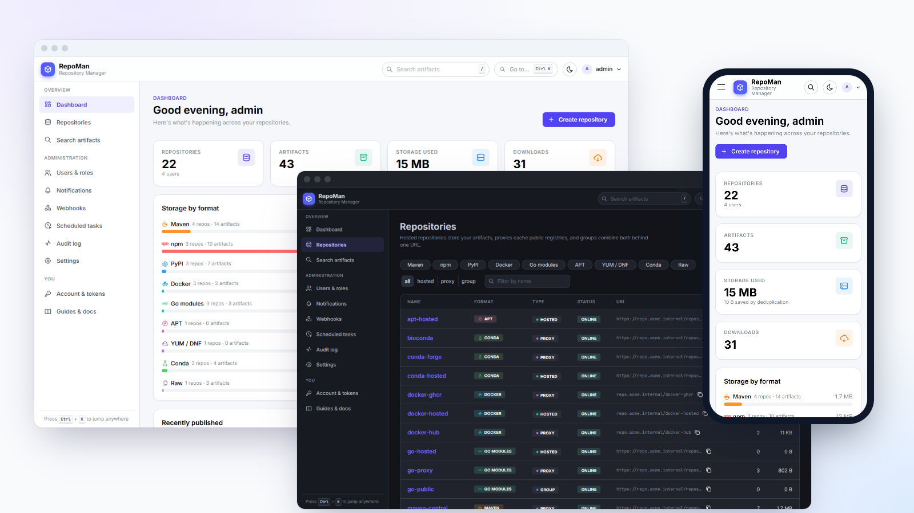
</p>

**A self-hosted artifact repository manager in a single binary.** Host your own builds, cache the public
registries, and give every tool one URL to pull from — for Maven, npm, PyPI, Docker, Go, APT, YUM, Conda and plain files.

RepoMan is one static Go executable with the web UI embedded, a SQLite database and a deduplicating blob
store on disk. There is nothing else to install: no JVM, no external database, no Redis, no object store.

- **Runs where the internet doesn't.** RepoMan contacts only the upstream registries you configure (and your
  own SSO, webhook and notification servers). No telemetry, no update checks, no CDN: the UI's fonts, icons and
  scripts ship inside the binary, and a content security policy enforces it. Build machines need a route to
  RepoMan and nothing else. See [Firewalls and air-gapped networks](docs/firewall.md).
- **Runs anywhere.** Linux, macOS and Windows on x86-64 and ARM (including Raspberry Pi), as a system service or
  a container.
- **Secure by default.** No default password, scoped API tokens, per-repository access, signed APT/YUM indexes,
  an audit log, and a sandbox for everything it serves. See [Security](docs/security.md).

> Downloads for every platform are on the [Releases page](https://github.com/anand34577/repoman/releases).
> See [CHANGELOG.md](CHANGELOG.md) for what changed in each release.

## Screenshots

| | |
|---|---|
| 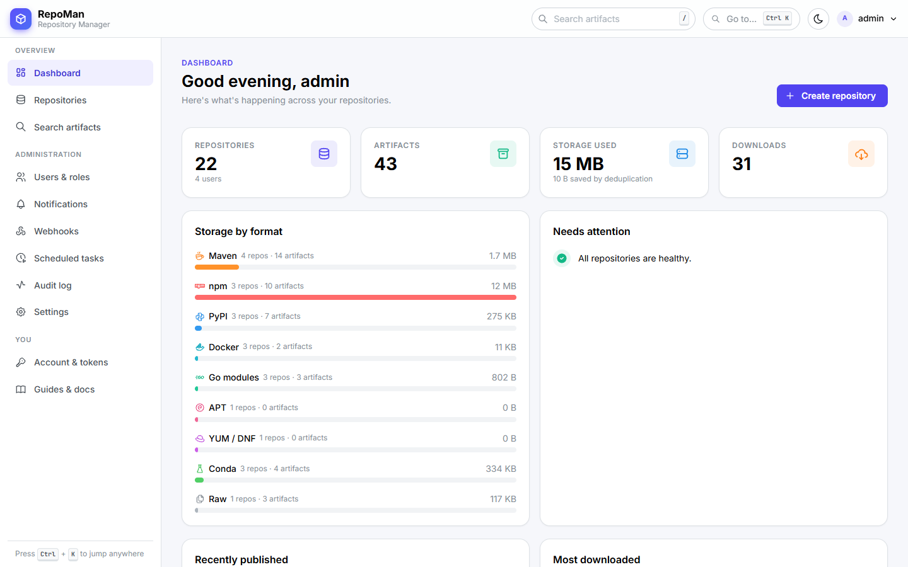<br>**Dashboard**: storage by format, health, recent uploads | 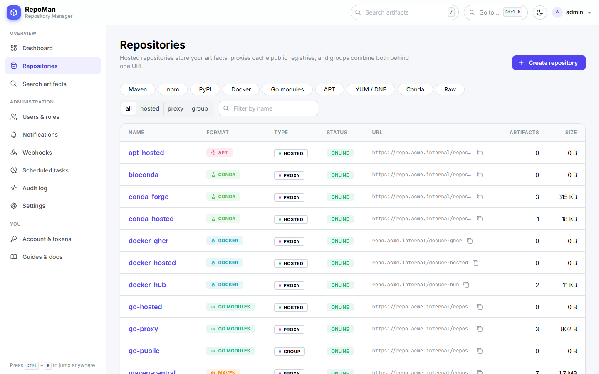<br>**Repositories**: every format, hosted, proxy and group, in one list |
| 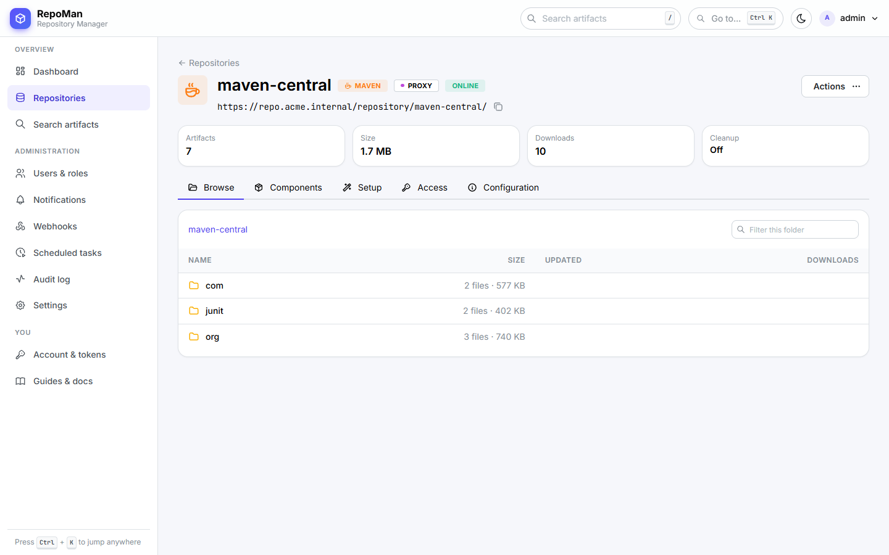<br>**Browse** what a proxy has cached or what you published | 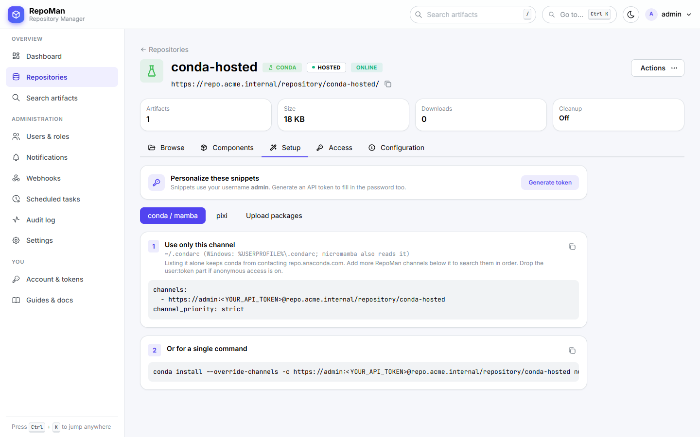<br>**Setup**: copy-paste client configuration for each repository |
| 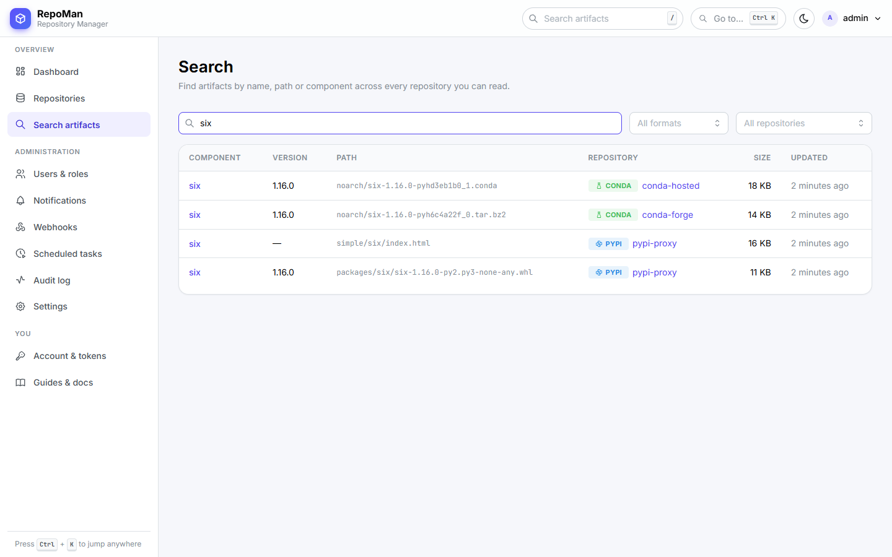<br>**Search** across every repository and format | 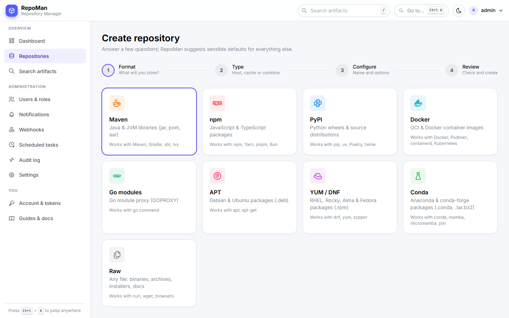<br>**Guided wizard** for new repositories |
| 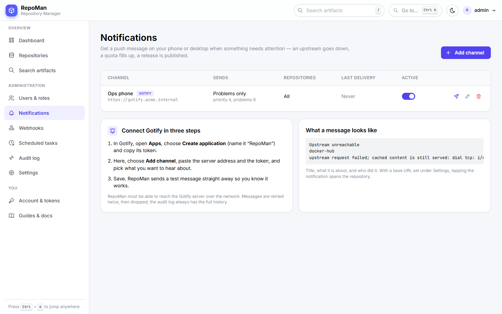<br>**Gotify notifications** when an upstream goes down or a release lands | 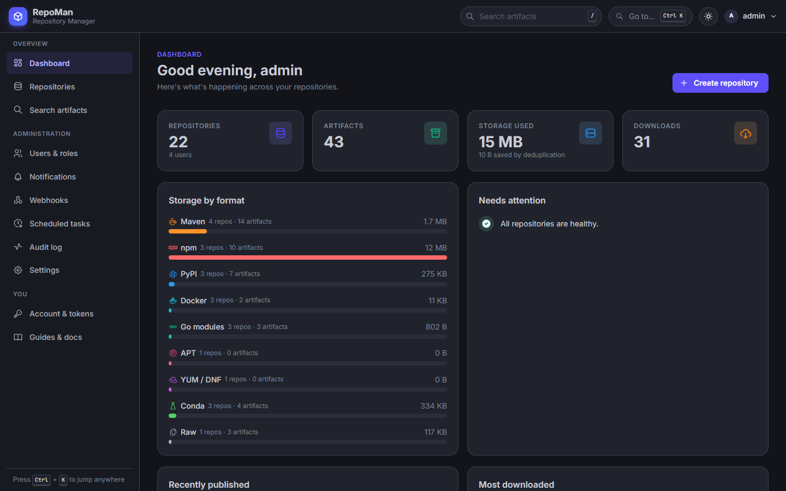<br>**Dark mode**, automatic |

<p align="center">
  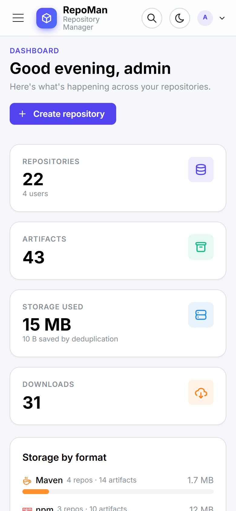
  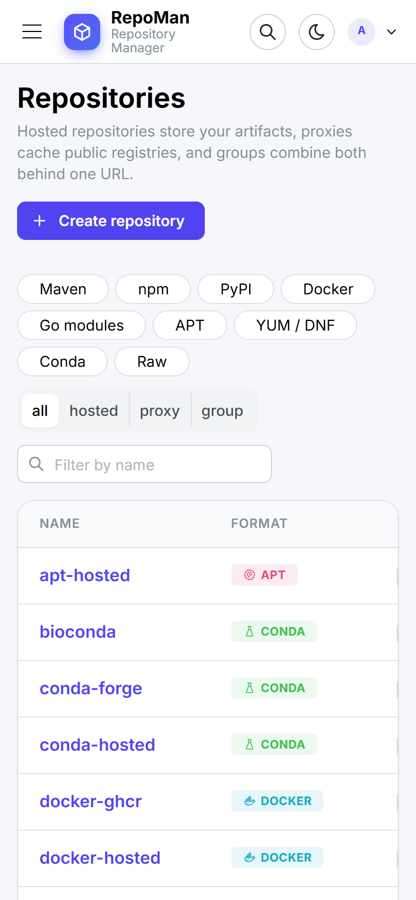
</p>

## Features

| | |
|---|---|
| **Formats** | Maven · npm · PyPI · Docker/OCI (also Helm charts over OCI) · Go modules · APT · YUM/DNF · Conda · raw files |
| **Repository types** | **Hosted** (your builds), **proxy** (a caching mirror of a remote), **group** (several repositories behind one URL) |
| **Storage** | Content-addressed: identical files are stored once. Quotas, cleanup policies with dry-run preview, integrity check |
| **Resilience** | Proxies keep serving cached content when the upstream is down, and tell you when it goes down and comes back |
| **Access control** | Viewer / developer / admin roles, per-repository overrides, private repositories, optional anonymous read |
| **Sign-in** | Local accounts, OpenID Connect single sign-on (Keycloak, Entra ID, Okta, Authentik, Google…), brute-force lockout |
| **API** | REST API under `/api/v1` for everything the UI does; tokens scoped to read-only, read & publish, or full access |
| **Notifications** | Push messages through [Gotify](https://gotify.net); HMAC-signed webhooks for automation |
| **Operations** | Prometheus metrics, health probe, scheduled maintenance tasks, configuration export/import, built-in TLS |
| **UI** | Guided repository wizard, copy-paste client setup for every tool, search, command palette (Ctrl+K), light/dark |

Format support in detail:

| Format | Hosted | Proxy | Group | Clients |
|---|:-:|:-:|:-:|---|
| Maven | ✓ | ✓ | ✓ merged `maven-metadata.xml` | mvn, Gradle, sbt |
| npm | ✓ publish, login | ✓ | ✓ | npm, pnpm, Yarn, Bun |
| PyPI | ✓ twine / poetry upload | ✓ | ✓ merged index | pip, uv, Poetry |
| Docker / OCI | ✓ push, pull, layer dedupe | ✓ Docker Hub, GHCR, Quay… | ✓ pull | docker, podman, containerd, Kubernetes, helm (OCI) |
| Go modules | ✓ upload `.mod` / `.zip` | ✓ incl. checksum database relay | ✓ merged versions | go |
| APT | ✓ `.deb`, GPG-signed indexes | ✓ Debian, Ubuntu | — | apt |
| YUM / DNF | ✓ `.rpm`, signed repodata | ✓ Rocky, Alma, EPEL… | — | dnf, yum |
| Conda | ✓ `.conda` / `.tar.bz2`, generated repodata | ✓ conda-forge, bioconda, Anaconda | — | conda, mamba, micromamba, pixi |
| Raw | ✓ any file | ✓ | ✓ | curl, wget, anything HTTP |

## Quick start

Pick one. In every case RepoMan then listens on **http://localhost:8081**.

**Linux and macOS: one line** (downloads the right build, verifies its checksum, installs it as a service)

```bash
curl -fsSL https://raw.githubusercontent.com/anand34577/repoman/main/scripts/get.sh | sudo sh
```

Run it again to upgrade (the database is backed up first); `... | sudo sh -s -- rollback` undoes an upgrade and
`... | sudo sh -s -- migrate-from /path/to/data` adopts existing data. See
[Installation](docs/installation.md#one-line-install-linux-and-macos).

**Docker**

```bash
docker run -d --name repoman -p 8081:8081 -v repoman-data:/data ghcr.io/anand34577/repoman:latest
docker logs repoman        # shows the generated admin password
```

**Linux** (systemd service, runs as its own unprivileged user)

```bash
tar -xzf repoman_<version>_linux_amd64.tar.gz && cd repoman_<version>_linux_amd64
sudo ./install.sh
sudo cat /var/lib/repoman/initial-admin-password
```

**macOS** (launchd service)

```bash
tar -xzf repoman_<version>_macos_arm64.tar.gz && cd repoman_<version>_macos_arm64
sudo ./install.sh
```

**Windows** (service; run in an elevated PowerShell)

```powershell
Expand-Archive repoman_<version>_windows_amd64.zip -DestinationPath . ; cd repoman_<version>_windows_amd64
Set-ExecutionPolicy -Scope Process Bypass -Force
.\install.ps1 -OpenFirewall
```

**Just try it** (any OS, no installation: data goes to `./data`)

```bash
./repoman
```

Download archives from the [releases page](https://github.com/anand34577/repoman/releases). Use `arm64` for
Apple silicon, Raspberry Pi 4/5 and other 64-bit ARM machines, `armv7`/`armv6` for 32-bit Raspberry Pi OS.

### First sign-in

1. Open http://localhost:8081 and sign in as **`admin`**. The password was generated on first start; it is
   printed once in the log and stored in `initial-admin-password` in the data directory.
2. Change the password (*Account*). The password file is deleted when you do.
3. Follow the checklist on the dashboard: set the public URL, create a token, connect a client.

A fresh installation already contains a typical set of repositories for every format — for example
`npm-hosted` (your packages), `npm-proxy` (a cache of npmjs.org) and `npm-public` (both behind one URL).
Open a repository and its **Setup** tab gives you copy-paste configuration for each client.

Forgot the admin password? Run `repoman reset-password` on the server ([details](docs/operations.md#reset-a-lost-password)).

> **Before others use it:** serve RepoMan over HTTPS. Either set `RM_TLS_CERT`/`RM_TLS_KEY` or put it behind
> a reverse proxy; both are described in [Configuration](docs/configuration.md#https). Docker and several other
> clients refuse plain HTTP for anything but `localhost`.

## Documentation

| | |
|---|---|
| [Installation](docs/installation.md) | Every platform step by step, services, Docker, upgrading, uninstalling |
| [Configuration](docs/configuration.md) | Settings reference, HTTPS, reverse proxies, logging, outbound proxy |
| [Firewalls and air-gapped networks](docs/firewall.md) | Exactly what RepoMan connects to, per upstream |
| [Repositories and formats](docs/repositories.md) | Hosted / proxy / group, per-format client setup and edge cases, cleanup, quotas |
| [Security](docs/security.md) | Roles, token scopes, SSO, hardening checklist, what is stored where |
| [Notifications and webhooks](docs/notifications.md) | Gotify setup, webhook payloads, the event catalogue |
| [REST API](docs/api.md) | Authentication, every endpoint, examples |
| [Operations](docs/operations.md) | Backup and restore, monitoring, maintenance tasks, password recovery, moving servers |
| [Troubleshooting](docs/troubleshooting.md) | Symptoms and fixes, by client |

The same guidance, tailored to your server's address, is in the UI under **Guides & docs**.

## Configuration at a glance

Process settings come from environment variables, a `repoman.env` file next to the binary, or flags.
Everything else is configured in the UI or through the API.

| Variable | Default | Purpose |
|---|---|---|
| `RM_ADDR` | `:8081` | Listen address |
| `RM_DATA_DIR` | `data` | Database and artifacts. **Back this up.** |
| `RM_ADMIN_PASSWORD` | *(random)* | Admin password for the first start only |
| `RM_TLS_CERT`, `RM_TLS_KEY` | — | Serve HTTPS directly |
| `RM_TRUSTED_PROXIES` | loopback | Reverse proxies whose `X-Forwarded-*` headers are believed |
| `RM_LOG_FILE` | — | Also log to a rotated file |
| `RM_ACCESS_LOG` | `true` | Log every request |

Full reference: [docs/configuration.md](docs/configuration.md).

## Building from source

Requires Go 1.26+ and Node.js 22+.

```bash
npm --prefix frontend ci && npm --prefix frontend run build   # UI → backend/ui/dist (embedded)
go -C backend build -o ../repoman .                           # → ./repoman
go -C backend test ./...                                      # end-to-end tests for every format
```

`make build`, `make test` and `make release` wrap the same commands. See [CONTRIBUTING.md](CONTRIBUTING.md)
for the development workflow and the code layout.

## Known limits

RepoMan aims to do the common things well with very little machinery. What it deliberately does not do (yet):

- **One node, local disk.** No clustering, replication or S3 storage. Scale up, snapshot the volume, back up the directory.
- **APT and YUM cannot be grouped**: their signed indexes cannot be merged. List several sources in the client instead.
- **Conda cannot be grouped**: public channel indexes are too large to merge per request. List several channels in `.condarc`.
- **npm**: `unpublish`, `deprecate`, `dist-tag` and `npm search` are not implemented; delete versions in the UI. `npm audit` is not proxied.
- **Proxies download a file completely before serving it** the first time; very large first downloads start with a pause.
- **No vulnerability scanning**, no LDAP/SAML (use OIDC), and SSO does not map provider groups to roles.
- **Secrets in the database are not encrypted at rest** (upstream passwords, the signing key); protect the data
  directory with file permissions and disk encryption. See [Security](docs/security.md#what-is-stored-and-how).

## Contributing and security

Contributions are welcome: see [CONTRIBUTING.md](CONTRIBUTING.md). Please report vulnerabilities privately as
described in [SECURITY.md](SECURITY.md), not in public issues.

## License

[MIT](LICENSE)
